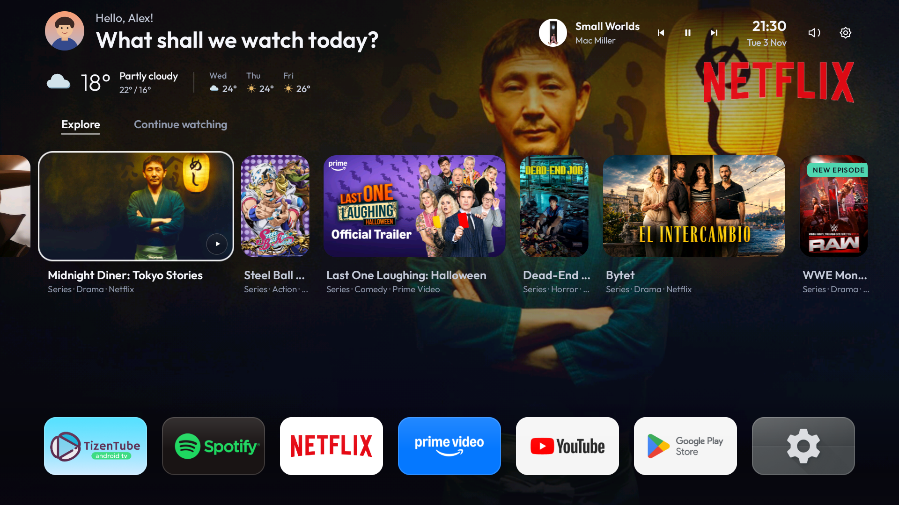
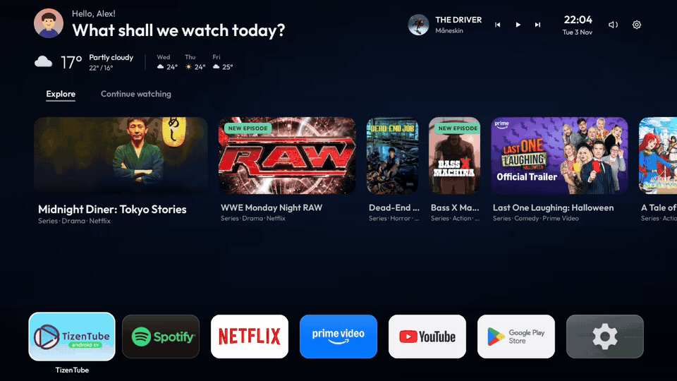
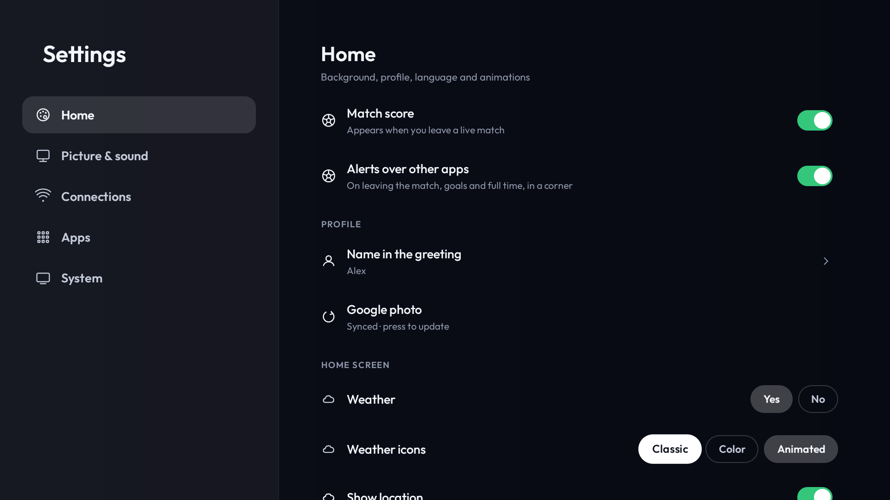
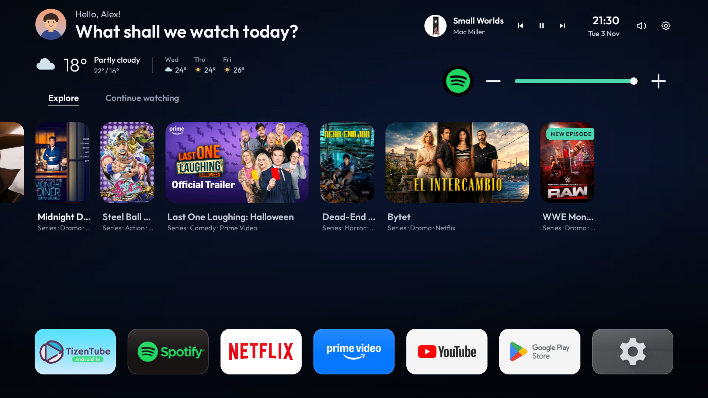
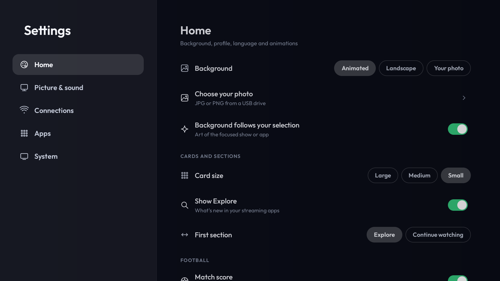
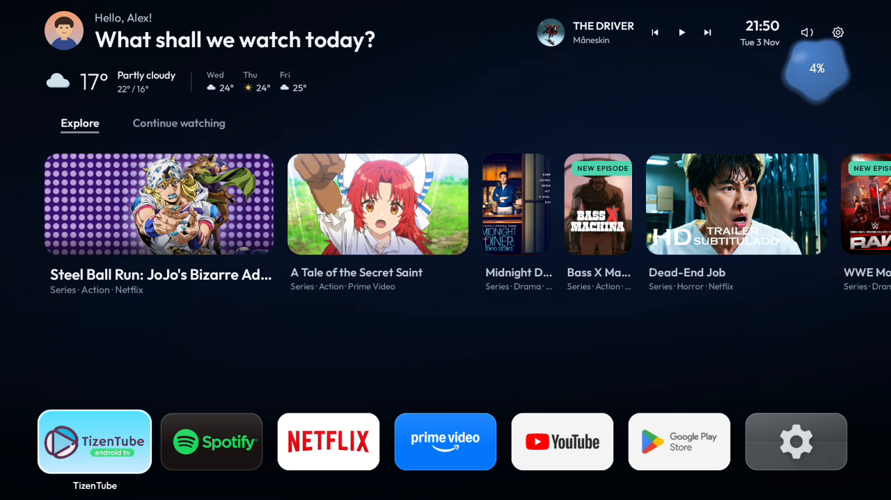
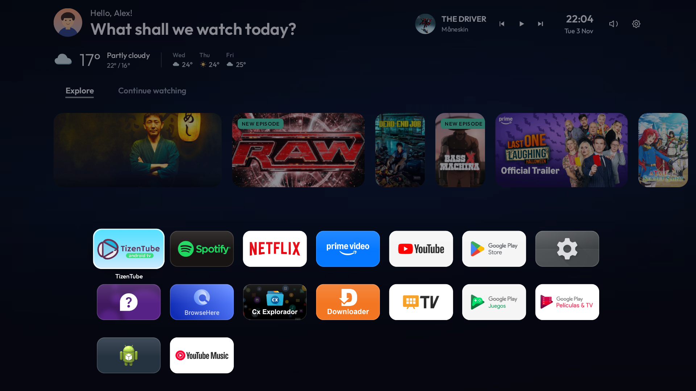
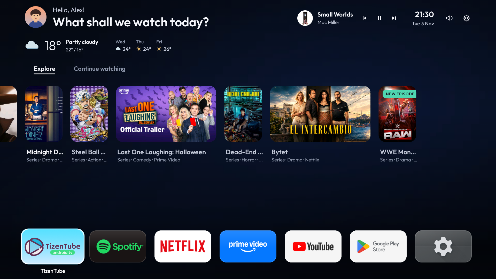

# HorizonX

Performance and interface improvements for televisions.

[Español](README.md) &nbsp; / &nbsp; [English](README.en.md) &nbsp; / &nbsp; [Português](README.pt.md)

[Website](https://webdesing-40d1a.web.app/) &nbsp; · &nbsp; [Downloads](#downloads) &nbsp; · &nbsp; [Compatibility and older TVs](#compatibility-and-older-tvs)

## All your apps, one gesture away

From the app row, press ↑ or ↓ to expand the grid. Browse with the arrows and press Back to return.

### Weather and audio

  
  

### Settings and volume

  
  

### Apps and wallpapers

  
  

---

## Get HorizonX

Current version: **3.11.0** · build 56.

Choose how to install it. Both downloads contain HorizonX **3.11.0** for Android TV / Google TV.

 

**TV / USB / Downloader:** install the APK on your TV.

**PC / ADB:** the ZIP includes the APK and installation assistant.

---

## Features

Home with installed applications, animated cards, Library, clock, weather, a music widget and backgrounds that follow the selected content. Available features depend on the TV firmware, permissions and the apps that share playback data.

Weather icons can be classic, colored or animated under Settings → Home. Only the current icon animates while Home is visible; forecast icons stay static. The greeting is above the weather.

The sound shortcut is a volume-only mixer: each app’s real icon, −, a track and +, without cards or duplicate playback controls. Up/down selects an app; left/right adjusts its volume, including held keys. With no players, it shows a brief notice. The separate music widget has **previous, play/pause and next**, using real sessions and MediaBrowser for paused-session recovery. Per-app adjustments end when the app closes and do not change master volume. Android audio focus may pause Spotify when YouTube plays; simultaneous playback is not forced. Authorized ADB and compatible firmware APIs are required: Android 8+ for Java players, Android 9+ for native session effects. HDMI passthrough, DRM and every manufacturer are not universally supported.

Wallpaper choices are **Animated, Landscape and Your photo**; Aurora and Night were removed. The silent video loop is about 109 KiB, hardware decoded at 960×540/20 fps. Its decoder is released when artwork covers it or Home goes into the background. Unsupported hardware, low-RAM devices, power saving or disabled motion use the static landscape.

Explore and Continue watching exclude browsers across preview, history and playback sources. Continue watching uses actual shared playback, not recently visited apps. Cards open their originating application. Generic YouTube recommendations are never labelled subscriptions: only explicit subscription rows or the authorized official API qualify. The read-only OAuth integration is implemented and tested against simulated responses; **HorizonX’s Google Cloud OAuth client and a real account’s consent still need configuring**, so this build does not automatically synchronize subscriptions yet.

The football widget follows only one fixture identified by both teams in actual playback metadata or a visible player. It never guesses by country or channel. Missing player information or scoreboard coverage keeps it hidden.

## USB APK installation

1. Download the [Android APK](https://github.com/2207juan/HorizonX/raw/refs/heads/main/dist/HorizonX-3.11.0.apk), copy it to your USB drive and open the drive on the TV using a file manager.
2. Allow that file manager to install unknown apps if requested. Select **Install**, or **Update** if HorizonX is already installed. Keep the existing installation to preserve its data.
3. Open HorizonX. Select it under the TV's Default apps / Home settings if that selector is available. Older Android 6/7 uses this manual route.
4. If the OEM forces its own Home, use HorizonX → Settings → System → Set up HorizonX. Follow the debugging authorization steps. If local ADB is unavailable, use the PC assistant below.
5. Test Home from another app and a normal power-on. Installing/updating the APK alone does not prove Home activation.

USB installation itself does not need developer mode. Advanced Home/volume/system changes may require authorized debugging. Do not turn debugging off during an ADB transaction.

## PC / ADB installation

Download and extract the [PC package](https://github.com/2207juan/HorizonX/raw/refs/heads/main/dist/HorizonX-PC-3.11.0.zip); it includes the APK. Install Python 3.10+ and [Android Platform Tools](https://developer.android.com/tools/releases/platform-tools). Enable the debugging option available on your TV under Developer options; enable Developer options by pressing Build seven times under Settings → System → About, if needed.

Connect both devices to the same network. With wireless debugging, pairing and connection ports are different: use `adb pair IP:PAIRING_PORT` only if pairing is required, then supply the connection address to the assistant. Accept the TV authorization. Run `HorizonX.cmd` on Windows or `sh HorizonX.sh` on Linux/macOS; choose connect, then install/configure. Home and package changes require separate authorization.

Updates keep the stable internal package identity `tv.lightos` to retain data. The visible app name is HorizonX. To restore: Settings → System → Back to the original Home, or the matching assistant/backup if HorizonX cannot be opened. Restore the original Home before removing the only working launcher.

## Other platforms

Use **only** your OS folder under `otras-plataformas/`. The folders contain distinct OS builds, not additional components that every TV needs. Every assistant supports `--help`. Use the matching installer below; the Android APK is not an LG or Samsung package.

LG requires LG Developer Mode, a paired device and the official LG CLI. Samsung requires Developer Mode and the owner's signing certificates. Roku uses the development channel installer and can hold only one development channel. VIDAA installation/hosting depends on the firmware. Fire requires authorized ADB; Home activation/restoration uses an explicit plan and token. No helper supplies an exploit or silently grants root.

| Platform | Installer | Start / restore |
|---|---|---|
| Fire OS | `otras-plataformas/amazon-fireos/installer/` · `HorizonX-FireTV.cmd` / `sh HorizonX-FireTV.sh` | Authorized ADB. `home-plan` creates a backup/token; `home-activate` requires approval; `home-restore` restores the backup |
| LG webOS | `otras-plataformas/lg-webos/installer/` · `python3 horizonx_webos.py install --device NAME --ipk FILE.ipk` | Paired LG CLI device and Developer Mode. `launch` opens the app. Advanced `home-plan` / `home-activate` / `home-restore` require existing root and verified APIs |
| Samsung Tizen | `otras-plataformas/samsung-tizen/installer/` · `python3 horizonx_tizen.py install --tv IP` | Developer Mode, SDB and owner signing certificates. Disable an enabled watcher before `uninstall`. Native integration has its own backup |
| Roku | `otras-plataformas/roku-os/installer/` · `python3 horizonx_roku.py install --roku IP` | Developer Mode, account and developer installer password. One development channel at a time. `remove` removes it; Home remains Roku |
| VIDAA | `otras-plataformas/hisense-vidaa/installer/` · `python3 horizonx_vidaa.py` | Firmware-dependent web installation; `--app-url URL` requires reachable hosting. Remove the app using the TV's supported options |

## Compatibility and older TVs

The existing Android design is preserved. HorizonX changes the home interface; it does not replace the operating system or firmware.

| Platform | Code compatibility target | Actual Home support |
|---|---|---|
| Android TV / Google TV | Android **6–16**, API 23–36, including 11/12/13/14 | Home selector or firmware-dependent ADB activation. Android 6/7 uses manual Home selection. ADB update to 3.11.0, Home and volume tested on Philips TA7 / Android 14; older versions have API/build checks, not hardware certification |
| Fire OS | Fire OS **6/7/8**; newer 14/16 families according to installed Android API | Separate Fire APK; boot/accessibility integration is firmware-dependent and not physically certified |
| LG webOS | **3.x through 26**: 3/4/5/6/22/23/24/25/26 | IPK; experimental advanced Home integration requires existing root and supported APIs. Developer Mode installation alone is not Home replacement |
| Samsung Tizen | **2.3–10.0**, documented 2015–2026 generations | Signed WGT; limited watcher. Native path requires existing root and strict probes. Universal Home replacement is not claimed |
| Roku OS | **9.1+** development channel and screensaver | **Does not replace Home**; other apps may be opened externally over ECP |
| VIDAA | Documented Chromium 53+ engines; firmware-dependent URL installation | Hosted web app; **does not replace Home** |

These are software targets, not certification of every listed television. Android below API 23, Fire OS 5/API 22, LG NetCast/webOS 1–2, Samsung Orsay and Roku OS 3.1 are outside the supported package targets. Amazon Vega OS does not run Android APKs.

The [official-source catalog](companion/profiles/device-support.json) contains model identifiers, generation/version mappings and evidence labels. Inspect the **installed OS/API**, since model years can be misleading after updates. Catalog recognition never authorizes disabling services.

## Optimization, verification and resources

Analysis, individual approval, backup and restoration remain available. Imported removal lists have been removed: there are **no generic automatic package-removal recommendations** in this release. Unknown dependencies stay enabled. Package optimisation is not applied automatically, and an unchanged audit is not marked as completed optimisation. Review each proposed change on the actual device; matching a model is not evidence that its services are expendable.

Offline build, API checks, browser tests and emulation are distinct from hardware tests. The ADB update to 3.11.0, Home return and volume overlay were physically checked on Philips TA7 / Android 14 on November 3. Fresh installation and USB installation are still untested; no USB storage was detected. Boot, Home, protected settings, Google accounts, DRM and advanced volume behavior on other models still require their hardware. The advanced volume/profile bridge requires Android 8+ APIs; older Android uses its available fallback routes. Old TVs can also have obsolete TLS/DRM or unavailable online services.

The repository's directories and Markdown files do not consume TV RAM; only the selected installation package does. The public guides are split into Spanish (`README.md`), English (`README.en.md`) and Portuguese (`README.pt.md`); app source/build projects and signing keys are not distributed. Required resource licenses remain under `licenses/`: [Outfit OFL](licenses/Outfit-OFL.txt), [Kenney CC0](licenses/Kenney-CC0.txt) and Android library notices. Runtime TVmaze and Open-Meteo data retain their respective attribution/use terms. Service artwork and trademarks belong to their owners.
