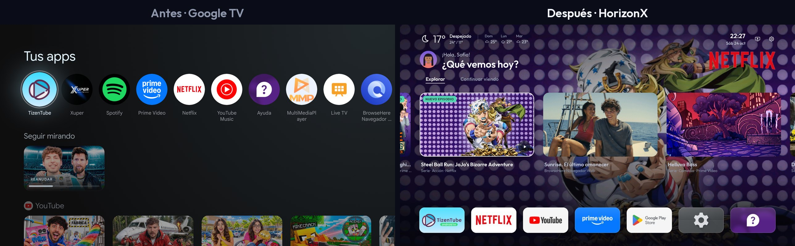
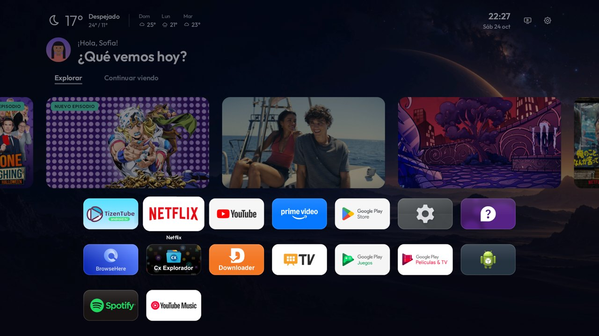
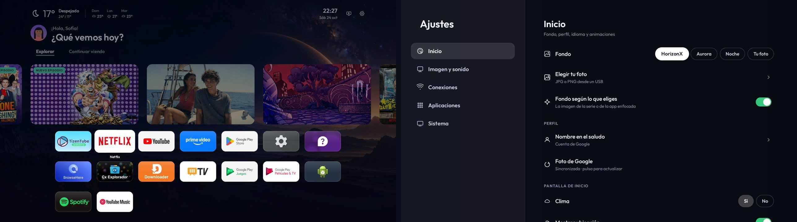

# HorizonX

**Mejora del rendimiento y de la interfaz para televisores Android TV y Google TV.**

[English](README.md) · [Televisores compatibles](docs/COMPATIBILIDAD.md) · [Descargar la APK 3.8.0](https://raw.githubusercontent.com/2207juan/HorizonX/main/dist/HorizonX-3.8.0.apk)

[Ver el vídeo completo (MP4)](https://raw.githubusercontent.com/2207juan/HorizonX/main/docs/media/horizonx-demo.mp4)

*Los perfiles de las capturas son de demostración.*

## Qué incluye

- Fondo que sigue lo que eliges y tarjetas que se expanden, como en Apple TV.
- Clima, saludo según la hora y tus apps en una fila que se abre con todas al pulsar arriba.
- *Explorar* con novedades distintas cada día y *Continuar viendo* con lo que ves en tus apps.
- Música sonando, animación al abrir apps, volumen "masa" y ajustes a pantalla completa.
- Español, inglés y portugués. APK de ~500 KB, sin anuncios.

## Instalación

**USB:** copia la [APK](https://raw.githubusercontent.com/2207juan/HorizonX/main/dist/HorizonX-3.8.0.apk) a un pendrive, ábrela en la tele con un gestor de archivos e instálala. Después abre HorizonX → **Ajustes → Sistema → Configurar HorizonX** para activar el inicio.

**PC (ADB):** descarga el [paquete para PC](https://raw.githubusercontent.com/2207juan/HorizonX/main/dist/HorizonX-PC-3.8.0.zip), descomprímelo y abre `HorizonX.cmd` (Windows) o `sh HorizonX.sh` (Linux/macOS). Elige **1. Conectar** y **2. Instalar**. Necesita Python 3.10+ y [Platform Tools](https://developer.android.com/tools/releases/platform-tools).

**Downloader:** `https://raw.githubusercontent.com/2207juan/HorizonX/main/dist/HorizonX-3.8.0.apk`

Paso a paso: [guía de instalación](docs/GUIA.md). Para deshacer: **Ajustes → Sistema → Volver al inicio original**.

## Otras plataformas (experimental)

Samsung Tizen, Roku, Fire TV y Hisense VIDAA tienen instaladores en [otras-plataformas](otras-plataformas/README.md). Aún no se han probado en esos televisores.
