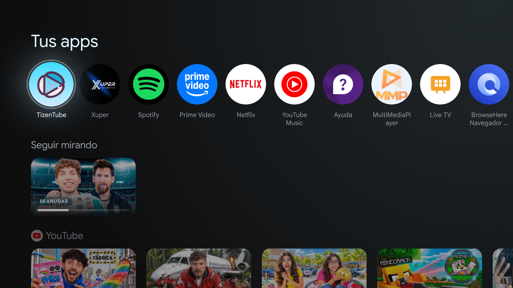
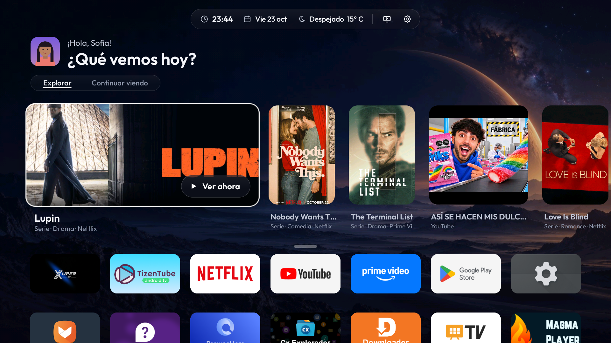
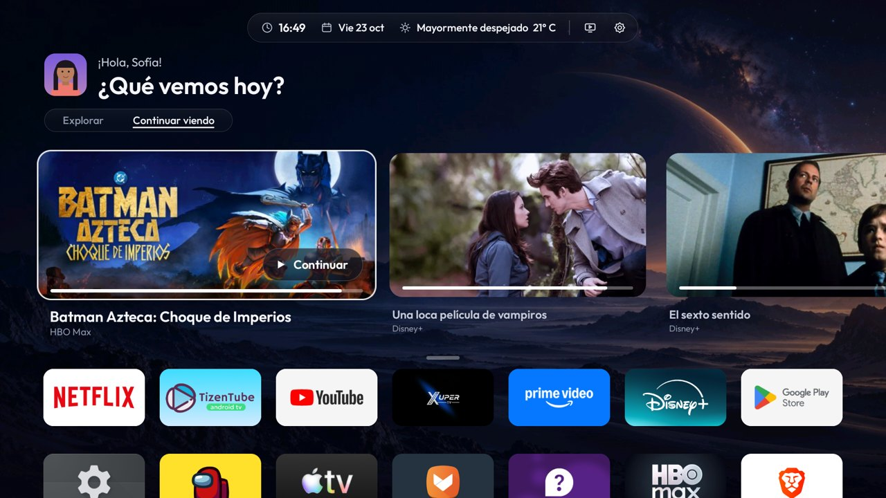
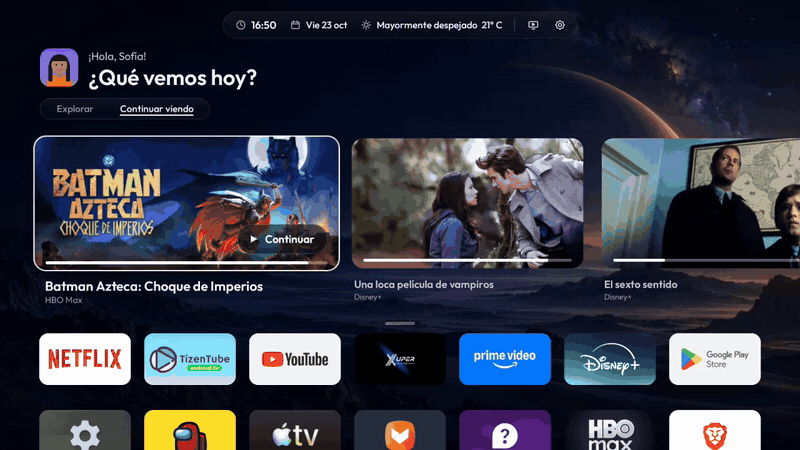

# HorizonX

**Pantalla de inicio ligera y bonita para Android TV y Google TV.** Reemplaza el inicio original, quita publicidad y telemetría, y cambia la barra de volumen del sistema por una animación propia.

[English](README.md) · [Televisores compatibles](docs/COMPATIBILIDAD.md) · [Descargar la APK](https://raw.githubusercontent.com/2207juan/HorizonX/main/dist/HorizonX-3.4.0.apk)

| Antes · Google TV | Después · HorizonX |
|---|---|
|  |  |

| Continuar viendo | Todas las apps |
|---|---|
|  |  |



*Los perfiles ilustrados de la galería son de demostración.*

## Funciones

- **Inicio**: foto de perfil y saludo, una sola barra arriba (hora · fecha · clima · HDMI · ajustes), pestañas *Explorar* y *Continuar viendo*, y todas las apps en una cuadrícula de 7 columnas sin fondo que se despliega al bajar.
- **Explorar**: novedades de los servicios de streaming que tienes instalados (TVmaze) y las filas que publican tus apps (YouTube, Spotify…). La mezcla y la forma de las tarjetas cambian cada día.
- **Continuar viendo**: lo que las apps comparten con Android (Disney+, HBO Max…), lo que HorizonX registra de las sesiones multimedia y las apps recientes.
- **Volumen "masa"**: se estira al subir, se aplasta al bajar y cambia de color según el nivel. Al mantener la tecla, el volumen sigue cambiando.
- **Ajustes rápidos**: Wi-Fi, Bluetooth, entradas HDMI, imagen, sonido, Ambilight (solo en teles que lo tienen), volumen, apariencia, idioma, apps y sistema.
- **Idiomas**: sigue el idioma del televisor (español, inglés y portugués), o puedes elegirlo en *Apariencia*.
- **Limpieza por modelo**: una base de datos de 252 televisores decide qué telemetría, anuncios y demos se pueden deshabilitar con seguridad. No se desinstala nada y todo se puede deshacer.
- **Ligero**: APK de ~460 KB, vistas nativas en Kotlin, sin web views ni frameworks pesados. En una Philips TA7, el 2,3 % de los cuadros llegan tarde, frente al 80 % de la versión anterior.

## Instalación

Ambos métodos instalan **la misma APK**. No necesitas compilar, tener Android Studio ni una cuenta de GitHub.

### 1. APK para USB

1. [Descarga HorizonX-3.4.0.apk](https://raw.githubusercontent.com/2207juan/HorizonX/main/dist/HorizonX-3.4.0.apk) en el ordenador o teléfono. Guarda el archivo APK, no la página de GitHub.
2. Copia la APK a un pendrive, conéctalo al televisor y ábrela con un gestor de archivos. Si Android lo pide, permite a ese gestor instalar aplicaciones desconocidas.
3. Instala o actualiza HorizonX y ábrelo. Para actualizar, no desinstales la versión anterior.
4. Para activar Inicio y el volumen propio, sigue **Ajustes → Configura HorizonX**. Cuando el firmware lo permita, activa **Depuración USB/ADB** en Opciones de desarrollador y acepta **«Permitir depuración» → «Permitir siempre»** para HorizonX.

Instalar la APK por sí solo no fuerza la elección de Inicio. Tras autorizar su ADB local, esta versión intenta conceder sus permisos, aplicar la limpieza por modelo y seleccionar Home. Son cambios en el televisor: puede apartarse el launcher Google TV, sin eliminar Android. Depende del firmware; activar Depuración USB no garantiza que el ADB local esté disponible en todas las teles. El flujo desde una instalación inicial y su continuidad tras reiniciar no están verificados en todos los modelos. Si la configuración no se completa, utiliza el PC. Sin ese acceso, HorizonX puede abrirse como una app.

### 2. ADB desde un PC

1. [Descarga el paquete ADB para PC (ZIP)](https://raw.githubusercontent.com/2207juan/HorizonX/main/dist/HorizonX-PC-3.4.0.zip) y **descomprímelo**. Ya contiene la APK; este ZIP no se instala en el televisor.
2. Instala **Python 3.10+** y [Android Platform Tools](https://developer.android.com/tools/releases/platform-tools). Añade Platform Tools al PATH o deja su carpeta `platform-tools` junto a `horizonx.py`.
3. Abre la carpeta extraída **HorizonX-PC**. En Windows ejecuta `HorizonX.cmd`; en Linux/macOS abre una terminal allí y ejecuta `sh HorizonX.sh`. También sirve `python3 horizonx.py` (`py -3 horizonx.py` en Windows).
4. Elige **1. Conectar televisor**, autoriza la depuración en la TV y después **2. Instalar HorizonX**. Acepta cambiar Inicio solo si quieres HorizonX como pantalla principal. La optimización separada muestra primero sus cambios. Al terminar, pulsa Home si seleccionaste HorizonX como Inicio, o ábrelo desde las aplicaciones de la TV.

Si la depuración inalámbrica pide emparejamiento, utiliza las dos direcciones y puertos que muestra tu televisor antes de abrir el asistente. Consulta la [guía paso a paso](docs/GUIA.md#2-instalar-con-un-pc-por-adb).

También puedes usar **Code → Download ZIP** o clonar esta distribución y abrir el asistente desde `companion/`:

```sh
git clone https://github.com/2207juan/HorizonX.git
cd HorizonX/companion
python3 horizonx.py
```

Clonar descarga los instaladores, no el código privado de Android. El asistente envía la APK por ADB; en este método no necesitas pendrive.

### 3. App Downloader

Introduce este enlace directo en Downloader. Tras instalar, sigue la configuración del método USB:

```text
https://raw.githubusercontent.com/2207juan/HorizonX/main/dist/HorizonX-3.4.0.apk
```

### Deshacer

En **Ajustes → Sistema** están **Deshacer la optimización**, **Volver al inicio original** y el interruptor **Volumen de HorizonX**. Conserva las copias que creen la app y el asistente. Consulta la [guía](docs/GUIA.md).
