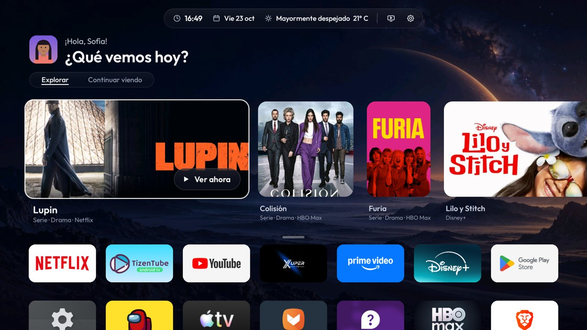

# HorizonX

**Pantalla de inicio ligera y bonita para Android TV y Google TV.** Reemplaza el inicio original, quita publicidad y telemetría, y cambia la barra de volumen del sistema por una animación propia.

## Distribución

Este repositorio contiene la APK compilada, el asistente de instalación ADB y las guías. No distribuye el código de la aplicación Android, el proyecto para compilarla ni archivos de firma. Los scripts Python sí están incluidos porque el asistente de instalación los necesita para funcionar.

[Descargar el instalador para PC](dist/HorizonX-PC-3.4.0.zip)

[English](README.md) · [Televisores compatibles](docs/COMPATIBILIDAD.md) · [Descargar la APK](dist/HorizonX-3.4.0.apk)

| Continuar viendo | Todas las apps |
|---|---|
|  |  |

*Los perfiles de las capturas ("Alex", "Sofia") son avatares ilustrados de demostración. En tu televisor, HorizonX muestra tu foto y tu nombre de Google.*

## Funciones

- **Inicio**: foto de perfil y saludo, una sola barra arriba (hora · fecha · clima · HDMI · ajustes), pestañas *Explorar* y *Continuar viendo*, y todas las apps en una cuadrícula de 7 columnas sin fondo que se despliega al bajar.
- **Explorar**: novedades de los servicios de streaming que tienes instalados (TVmaze) y las filas que publican tus apps (YouTube, Spotify…). La mezcla y la forma de las tarjetas cambian cada día.
- **Continuar viendo**: lo que las apps comparten con Android (Disney+, HBO Max…), lo que HorizonX registra de las sesiones multimedia y las apps recientes.
- **Volumen "masa"**: se estira al subir, se aplasta al bajar y cambia de color según el nivel. Al mantener la tecla, el volumen sigue cambiando.
- **Ajustes rápidos**: Wi-Fi, Bluetooth, entradas HDMI, imagen, sonido, Ambilight (solo en teles que lo tienen), volumen, apariencia, idioma, apps y sistema.
- **Idiomas**: sigue el idioma del televisor (español, inglés y portugués), o puedes elegirlo en *Apariencia*.
- **Limpieza por modelo**: una base de datos de 252 televisores decide qué telemetría, anuncios y demos se pueden deshabilitar con seguridad. No se desinstala nada y todo se puede deshacer.
- **Ligero**: APK de ~460 KB, vistas nativas en Kotlin, sin web views ni frameworks pesados. En una Philips TA7, el 2,3 % de los cuadros llegan tarde, frente al 80 % de la versión anterior.

## Instalación

### 1. Desde un USB (sin ordenador)

1. Copia `HorizonX-3.4.0.apk` a un pendrive e instálala con un gestor de archivos en la tele.
2. Ajustes del televisor → Sistema → Información → pulsa 7 veces **Compilación**. Después, en **Opciones de desarrollador**, activa **Depuración USB**.
3. Abre HorizonX y acepta **«¿Permitir depuración?»** con **Permitir siempre**.

Con ese único permiso, HorizonX hace el resto sola:

- se concede sus permisos;
- aplica la limpieza segura;
- **se pone como pantalla de inicio**, apartando Google TV sin borrarlo;
- activa su barra de volumen en cada arranque.

Sin depuración, HorizonX funciona como una app normal. En *Ajustes → Configura HorizonX* ofrece el selector de inicio del propio televisor cuando el firmware lo permite. En los modelos Google TV, el inicio original sigue mandando hasta usar la depuración.

### 2. Con un ordenador (ADB)

Instala Python 3.10+ y [Android Platform Tools](https://developer.android.com/tools/releases/platform-tools). Después haz doble clic en `companion/HorizonX.sh` (Linux/macOS) o `companion/HorizonX.cmd` (Windows) y sigue el menú numerado: conectar, instalar, optimizar, deshacer y compatibilidad.

### 3. App Downloader

En televisores con la app *Downloader*, escribe el enlace directo a `dist/HorizonX-3.4.0.apk` de este repositorio y sigue desde el paso 2 del método 1.

### Deshacer

En *Ajustes → Sistema*: **Deshacer la optimización**, **Volver al inicio original** y desactivar **Volumen de HorizonX**. El asistente de PC ofrece lo mismo.

## Créditos

Listas de modelos derivadas de [CleanYourTV](https://github.com/Gathin23/cleanyourtv) (MIT). Fuente Outfit (OFL). Ver [THIRD_PARTY_NOTICES.md](THIRD_PARTY_NOTICES.md).
