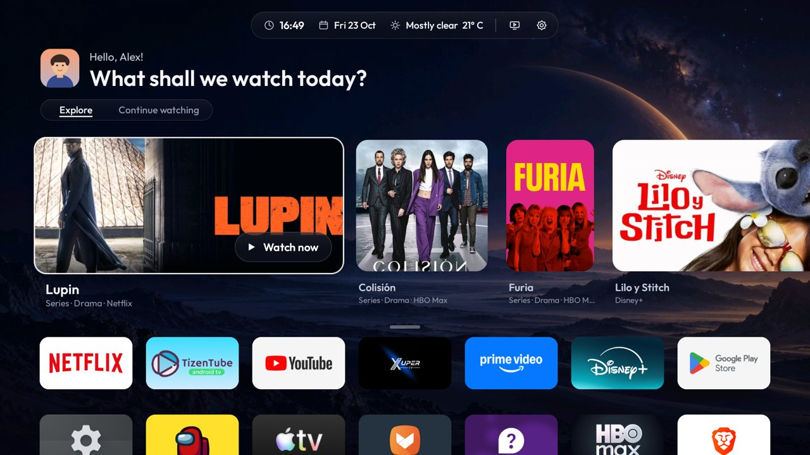

# HorizonX

**A light, good-looking home screen for Android TV and Google TV.** It replaces the stock home screen, removes ads and telemetry, and swaps the system volume bar for its own animated one.

## Distribution

This repository provides the compiled APK, the ADB installation assistant and user guides. The Android application source, build project and signing files are not distributed here. Python scripts are included because the installation assistant needs them to run.

[Download the PC installer](dist/HorizonX-PC-3.4.0.zip)

[Español](README.es.md) · [Compatible TVs](docs/COMPATIBLE_TVS.md) · [Download the APK](dist/HorizonX-3.4.0.apk)

| Continue watching (Spanish) | Settings (English) |
|---|---|
|  |  |

*The profiles shown in the screenshots ("Alex", "Sofia") are illustrated demo avatars. On your TV, HorizonX shows your own Google profile photo and name.*

## Features

- **Home**: profile photo and greeting, one top bar (time · date · weather · HDMI · settings), *Explore* and *Continue watching* tabs, and every app in a 7-column grid with no background that slides up when you go down.
- **Explore**: new shows from the streaming services you have installed (TVmaze) and the preview rows your apps publish (YouTube, Spotify…). The mix and the card shapes change every day.
- **Continue watching**: what apps share with Android (Disney+, HBO Max…), what HorizonX records from media sessions, and recently used apps.
- **"Dough" volume**: a soft blob that stretches when you raise the volume, squashes when you lower it, and changes colour with the level. Holding the key keeps changing the volume.
- **Quick settings**: Wi-Fi, Bluetooth, HDMI inputs, picture, sound, Ambilight (only on TVs that have it), volume, appearance, language, apps and system.
- **Languages**: follows the TV language (English, Spanish, Portuguese), or pick one in *Appearance*.
- **Clean-up per TV model**: a database of 252 TVs decides which telemetry, ad and demo components can be disabled safely. Nothing is uninstalled, and everything can be undone.
- **Light**: ~460 KB APK, native Kotlin views, no web views or heavy frameworks. Measured on a Philips TA7: 2.3 % late frames, against 80 % in the previous version.

## Install

### 1. From a USB drive (no computer)

1. Copy `HorizonX-3.4.0.apk` to a USB drive and install it with a file manager on the TV.
2. TV settings → System → About → press **Build** 7 times. Then in **Developer options**, turn on **USB debugging**.
3. Open HorizonX and accept **"Allow debugging?"** with **Always allow**.

With that single permission HorizonX does the rest by itself: it grants its own permissions, applies the safe clean-up, **becomes the home screen** (setting Google TV aside without deleting it) and turns on its volume bar at every boot.

Without debugging, HorizonX works as a normal app. *Settings → Set up* offers the TV's own home picker where the firmware allows it. Google TV models keep their stock home until debugging is used.

### 2. With a computer (ADB)

Install Python 3.10+ and [Android Platform Tools](https://developer.android.com/tools/releases/platform-tools). Then double-click `companion/HorizonX.sh` (Linux/macOS) or `companion/HorizonX.cmd` (Windows) and follow the numbered menu: connect, install, optimise, undo, compatibility.

### 3. Downloader app

On TVs with the *Downloader* app, enter the raw link to `dist/HorizonX-3.4.0.apk` from this repository, then continue from step 2 of method 1.

### Undo

*Settings → System*: **Undo the optimisation**, **Back to the original home**, and turn off **HorizonX volume**. The PC assistant offers the same options.

## Credits

TV model lists derived from [CleanYourTV](https://github.com/Gathin23/cleanyourtv) (MIT). Outfit font (OFL). See [THIRD_PARTY_NOTICES.md](THIRD_PARTY_NOTICES.md).
