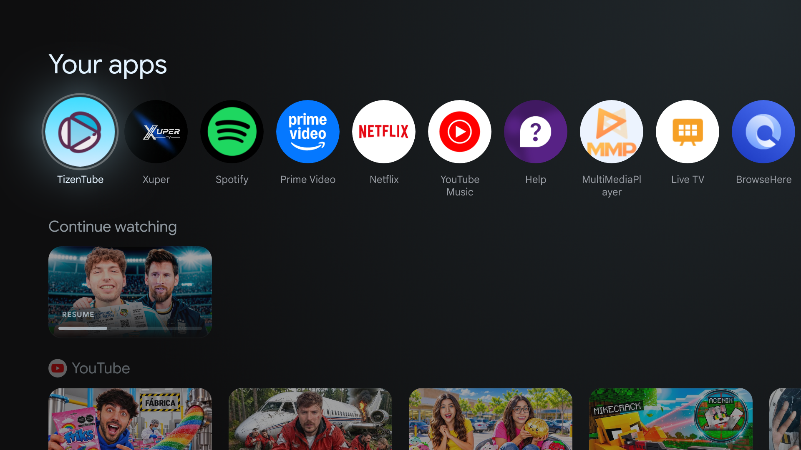
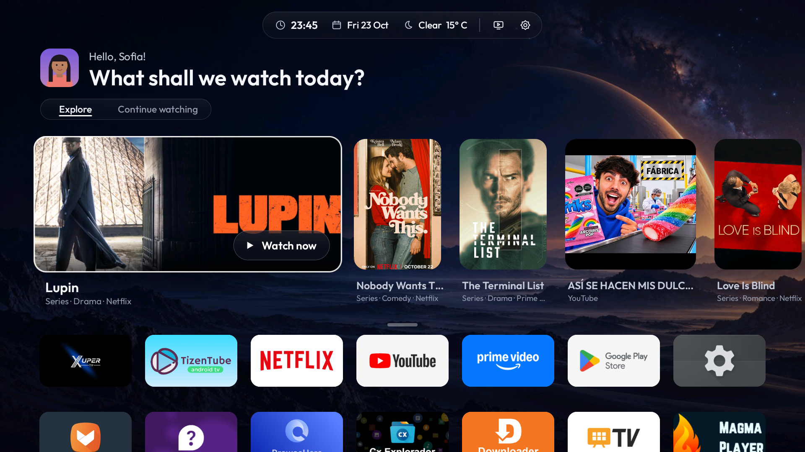
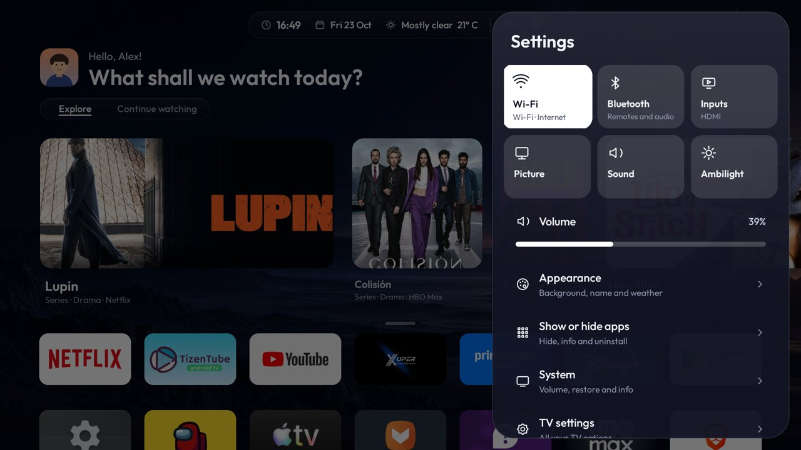

# HorizonX

**Performance and interface improvements for Android TV and Google TV televisions.**

[Español](README.es.md) · [Compatible TVs](docs/COMPATIBLE_TVS.md) · [Download the APK](https://raw.githubusercontent.com/2207juan/HorizonX/main/dist/HorizonX-3.4.0.apk)

| Before · Google TV | After · HorizonX |
|---|---|
|  |  |

| Continue watching (Spanish) | Settings (English) |
|---|---|
|  |  |


*The illustrated profiles in the gallery are for demonstration.*

## Features

- **Home**: profile photo and greeting, one top bar (time · date · weather · HDMI · settings), *Explore* and *Continue watching* tabs, and every app in a 7-column grid with no background that slides up when you go down.
- **Explore**: new shows from the streaming services you have installed (TVmaze) and the preview rows your apps publish (YouTube, Spotify…). The mix and the card shapes change every day.
- **Continue watching**: what apps share with Android (Disney+, HBO Max…), what HorizonX records from media sessions, and recently used apps.
- **"Dough" volume**: a soft blob that stretches when you raise the volume, squashes when you lower it, and changes colour with the level. Holding the key keeps changing the volume.
- **Quick settings**: Wi-Fi, Bluetooth, HDMI inputs, picture, sound, Ambilight (only on TVs that have it), volume, appearance, language, apps and system.
- **Languages**: follows the TV language (English, Spanish, Portuguese), or pick one in *Appearance*.
- **Clean-up per TV model**: a database of 252 TVs decides which telemetry, ad and demo components can be disabled safely. Nothing is uninstalled, and everything can be undone.
- **Light**: ~460 KB APK, native Kotlin views, no web views or heavy frameworks. Measured on a Philips TA7: 2.3 % late frames, against 80 % in the previous version.

## Install

Both methods install the **same APK**. No Android project, compilation or GitHub account is needed.

### 1. APK for a USB drive

1. [Download HorizonX-3.4.0.apk](https://raw.githubusercontent.com/2207juan/HorizonX/main/dist/HorizonX-3.4.0.apk) to your computer or phone. Save the file itself, not the GitHub web page.
2. Copy the APK to a USB drive, plug it into the TV and open it with a file manager. Allow that file manager to install unknown apps if Android asks.
3. Install or update HorizonX, then open it. Do not uninstall an existing installation to update it.
4. To activate the additional Home/volume features, follow **Settings → Set up HorizonX**. Where supported, enable **USB/ADB debugging** in the TV's developer options and accept HorizonX's **Allow debugging → Always allow** prompt.

Installing the APK alone does not force the Home selection. After ADB authorization, this version attempts to grant its permissions, apply its model-based clean-up and select Home. These changes affect the TV; Google TV's launcher can be disabled without deleting Android. Support depends on the firmware. The local ADB connection is not available on every TV merely by enabling USB debugging. Initial setup from a freshly installed TV and restart recovery have not been verified on every model; use the PC route if setup cannot complete. Without that access, HorizonX can still open as an app.

### 2. ADB from a PC

1. [Download the ADB package for PC (ZIP)](https://raw.githubusercontent.com/2207juan/HorizonX/main/dist/HorizonX-PC-3.4.0.zip) and **extract it**. It already includes the APK; do not copy this ZIP onto the TV.
2. Install **Python 3.10+** and [Android Platform Tools](https://developer.android.com/tools/releases/platform-tools). Put Platform Tools in your PATH, or extract its `platform-tools` folder beside `horizonx.py`.
3. Open the extracted **HorizonX-PC** folder. Windows: run `HorizonX.cmd`. Linux/macOS: run `sh HorizonX.sh` in a terminal. Alternatively run `python3 horizonx.py` (`py -3 horizonx.py` on Windows).
4. Choose **1. Connect TV**, authorize debugging on the TV, then **2. Install HorizonX**. Accept the Home selection only if you want HorizonX as your home screen. The separate optimisation option displays its proposed changes first. When finished, press Home if you selected HorizonX as your home screen, or open HorizonX from the TV app list.

Wireless debugging with pairing uses two ports. Pair and connect using the exact addresses shown by your TV, then start the assistant; see the [step-by-step guide](docs/GUIA.md#2-instalar-con-un-pc-por-adb).

You can also download **Code → Download ZIP** or clone this public distribution, then run the assistant from `companion/`:

```sh
git clone https://github.com/2207juan/HorizonX.git
cd HorizonX/companion
python3 horizonx.py
```

Cloning downloads the installation files, not the private Android source. The assistant transfers the APK over ADB; you do not need a USB drive for this route.

### 3. Downloader app

Enter this direct APK URL in Downloader, then follow the USB method's setup steps after installation:

```text
https://raw.githubusercontent.com/2207juan/HorizonX/main/dist/HorizonX-3.4.0.apk
```

### Undo

**Settings → System** offers **Undo the optimisation**, **Back to the original home**, and the **HorizonX volume** switch. Keep any backups created by the app or PC assistant. See the [guide](docs/GUIA.md).
