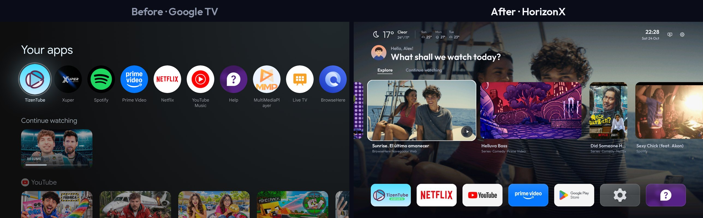
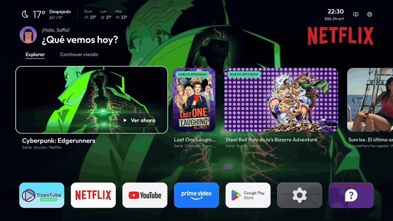
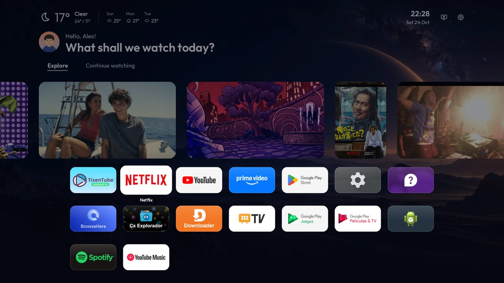
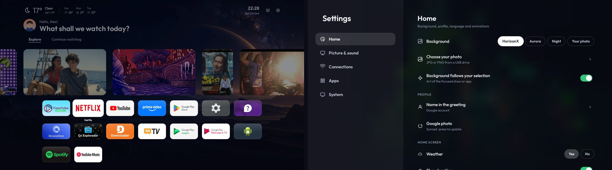

# HorizonX

**Performance and interface improvements for Android TV and Google TV televisions.**

[Español](README.es.md) · [Compatible TVs](docs/COMPATIBLE_TVS.md) · [Download APK 3.8.1](https://raw.githubusercontent.com/2207juan/HorizonX/main/dist/HorizonX-3.8.1.apk)

[Watch the full video (MP4)](https://raw.githubusercontent.com/2207juan/HorizonX/main/docs/media/horizonx-demo.mp4)

*Profiles shown in the screenshots are for demonstration.*

## What's inside

- A background that follows your selection and cards that expand, Apple TV style.
- Weather, a time-of-day greeting and your apps in one row that opens to all of them when you press up.
- *Explore* with a different mix every day, and *Continue watching* with what you watch in your apps.
- Card size (Large, Medium or Small), section order and the option to hide *Explore*, in **Settings → Home**.
- Now playing, app opening animation, "dough" volume and full-screen settings.
- English, Spanish and Portuguese. ~500 KB APK, no ads.

## Install

**USB:** copy the [APK](https://raw.githubusercontent.com/2207juan/HorizonX/main/dist/HorizonX-3.8.1.apk) to a USB drive, open it on the TV with a file manager and install it. Then open HorizonX → **Settings → System → Set up HorizonX** to make it your Home.

**PC (ADB):** download the [PC package](https://raw.githubusercontent.com/2207juan/HorizonX/main/dist/HorizonX-PC-3.8.1.zip), extract it and run `HorizonX.cmd` (Windows) or `sh HorizonX.sh` (Linux/macOS). Choose **1** (connect) and **2** (install). Needs Python 3.10+ and [Platform Tools](https://developer.android.com/tools/releases/platform-tools).

**Downloader:** `https://raw.githubusercontent.com/2207juan/HorizonX/main/dist/HorizonX-3.8.1.apk`

Step by step: [installation guide](docs/INSTALLATION.md). To undo: **Settings → System → Back to the original Home**.

## Other platforms (experimental)

Samsung Tizen, Roku, Fire TV and Hisense VIDAA have installers in [otras-plataformas](otras-plataformas/README.md). They have not been tested on those TVs yet.
