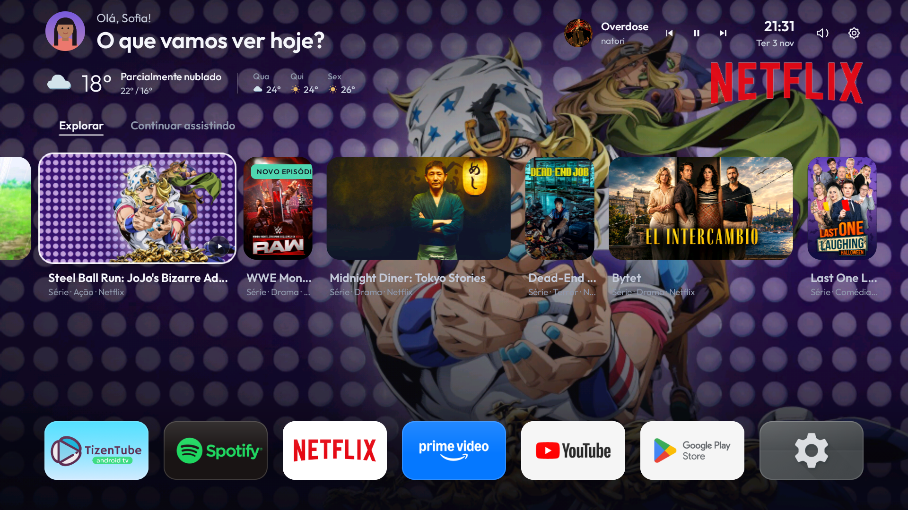
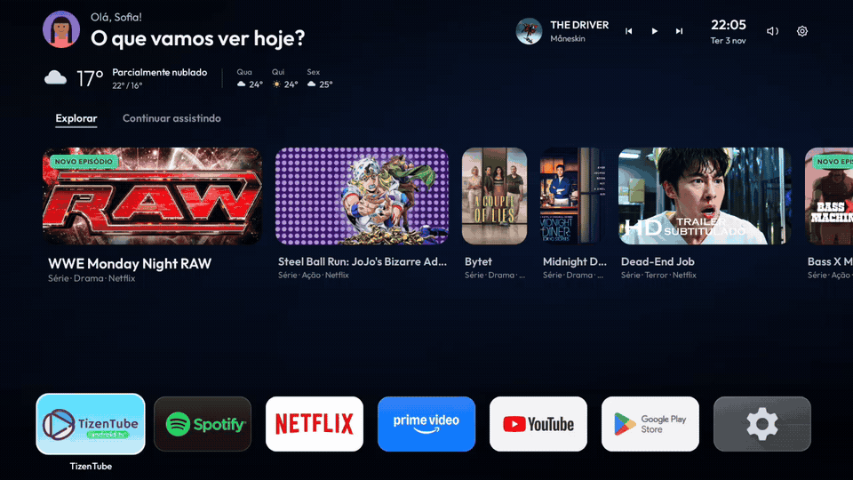
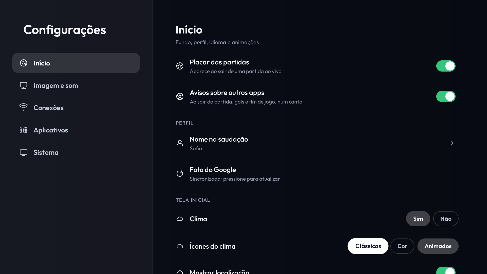
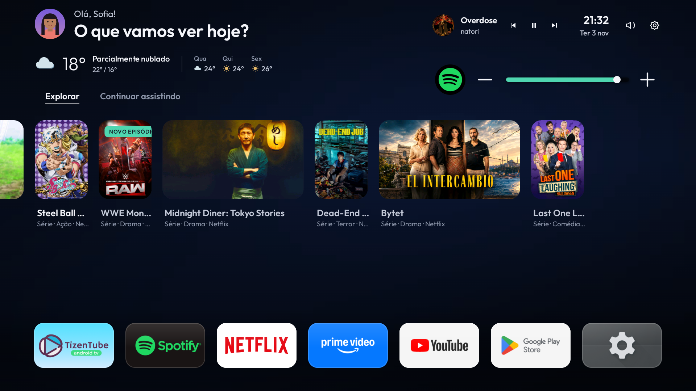
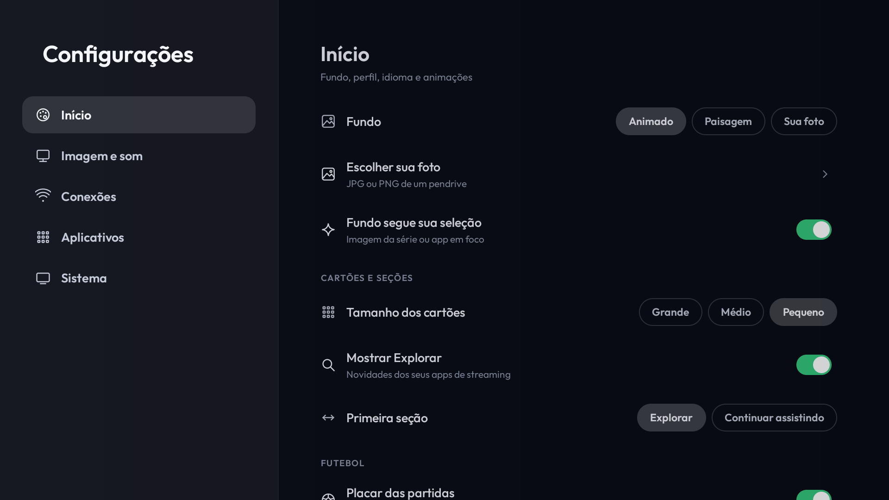
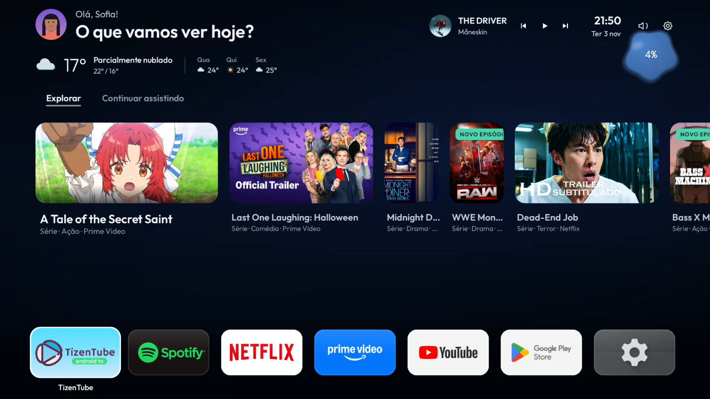
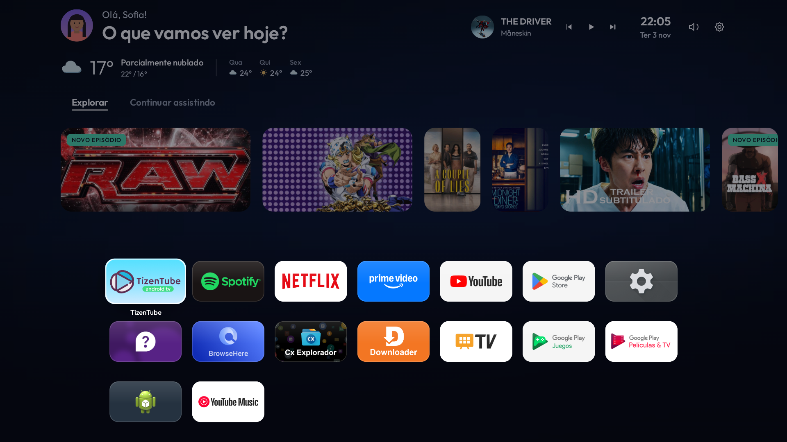
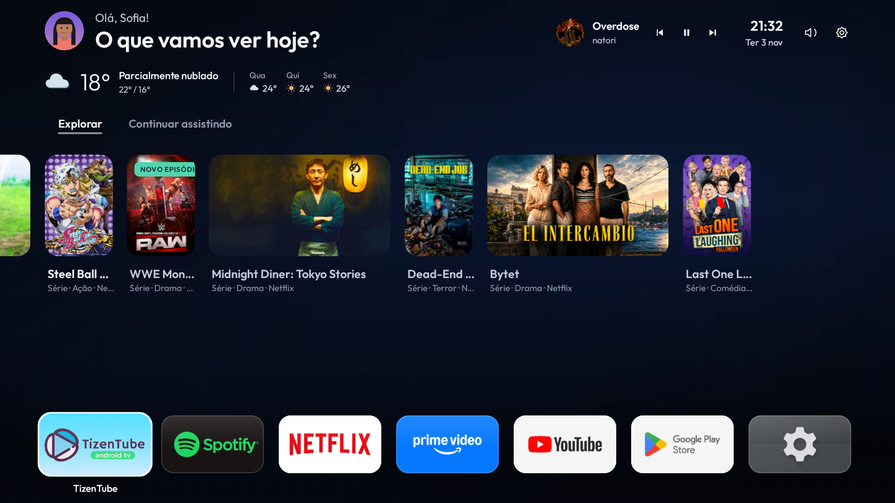

# HorizonX

Melhorias de desempenho e interface para televisores.

[Español](README.md) &nbsp; / &nbsp; [English](README.en.md) &nbsp; / &nbsp; [Português](README.pt.md)

[Site](https://webdesing-40d1a.web.app/) &nbsp; · &nbsp; [Downloads](#downloads) &nbsp; · &nbsp; [Plataformas e limites](#plataformas-e-limites)

## Todos os aplicativos em um gesto

Na fileira de aplicativos, pressione ↑ ou ↓ para expandir a grade. Navegue com as setas e pressione Voltar para retornar.

### Clima e áudio

  
  

### Configurações e volume

  
  

### Aplicativos e fundos

  
  

---

## Instale o HorizonX

Versão atual: **3.11.0** · compilação 56.

Escolha como instalar. Os dois downloads incluem HorizonX **3.11.0** para Android TV / Google TV.

 

**TV / USB / Downloader:** instale o APK na TV.

**PC / ADB:** o ZIP inclui o APK e o assistente de instalação.

---

## Recursos

Tela inicial com os aplicativos instalados, Biblioteca, cartões animados, imagem de fundo que acompanha a seleção, relógio e clima com ícones clássicos, coloridos ou animados. O widget musical tem **anterior, reproduzir/pausar e próxima**. O painel de áudio separado serve somente para volume: escolha o aplicativo com cima/baixo e ajuste com esquerda/direita. Sem reprodutores, aparece um aviso breve. O ajuste independente não modifica o volume geral nem força áudio simultâneo contra as regras de foco do Android.

Fundos: **Animado, Paisagem e Sua foto**. O vídeo silencioso usa decodificação por hardware, ocupa aproximadamente 109 KiB e libera o decodificador quando fica coberto ou você sai da tela inicial. Em aparelhos sem recursos suficientes, usa a paisagem estática.

Explorar e Continuar assistindo excluem navegadores. Continuar assistindo usa reprodução real compartilhada pelos aplicativos, não visitas recentes. As recomendações gerais do YouTube não são tratadas como inscrições. A integração oficial somente para leitura está implementada e tem testes simulados, mas **ainda precisa do cliente OAuth do HorizonX no Google Cloud e da autorização de uma conta real** para sincronizar inscrições.

O placar acompanha somente uma partida identificada pelos dois times na reprodução real. Não mostra todos os jogos por instalar um aplicativo esportivo. Catálogos, resumos e reprises não iniciam acompanhamento; sem dados suficientes, o widget fica oculto.

## Instalar Android por USB

1. Baixe o [APK Android 3.11.0](https://github.com/2207juan/HorizonX/raw/refs/heads/main/dist/HorizonX-3.11.0.apk) e copie-o para sua unidade USB.
2. Conecte a unidade à TV, abra um gerenciador de arquivos e localize o APK. O nome da unidade depende do seu pendrive.
3. Se solicitado, autorize esse gerenciador a instalar aplicativos desconhecidos. Escolha **Instalar**, ou **Atualizar** se o HorizonX já estiver instalado. Preserve a instalação existente para manter seus dados.
4. Abra o HorizonX. Se a TV oferecer Aplicativos padrão / Tela inicial, escolha HorizonX e confirme. Android 6/7 usa essa seleção manual.
5. Se o firmware impuser a tela inicial do fabricante, abra HorizonX → Configurações → Sistema → Configurar HorizonX. Siga a autorização de depuração quando disponível. Se o ADB local não funcionar, use o assistente do computador.
6. Verifique Home a partir de outro aplicativo e a inicialização normal. Instalar o APK não confirma a ativação de Home.

Instalar o APK por USB não exige depuração. A ativação avançada de Home, volume e alterações do sistema pode exigir ADB autorizado. Não desative a depuração durante uma operação ADB.

## Instalar Android pelo computador / ADB

1. Baixe e extraia o [instalador PC](https://github.com/2207juan/HorizonX/raw/refs/heads/main/dist/HorizonX-PC-3.11.0.zip), que inclui o APK.
2. Instale Python 3.10+ e [Android Platform Tools](https://developer.android.com/tools/releases/platform-tools). Verifique se `adb` funciona no terminal.
3. Na TV, abra Configurações → Sistema → Sobre. Se necessário, pressione Compilação sete vezes e ative a depuração disponível nas Opções do desenvolvedor.
4. TV e computador devem estar na mesma rede. Na depuração sem fio, a **porta de pareamento** é diferente da **porta de conexão**. Use `adb pair IP:PORTA_DE_PAREAMENTO` somente quando necessário e digite o código da TV. Não publique esse código.
5. Execute `HorizonX.cmd` no Windows ou `sh HorizonX.sh` no Linux/macOS. Escolha conectar, informe o IP e a porta de conexão atuais e aceite a autorização na TV. Depois escolha instalar/configurar. Alterações em Home e pacotes exigem autorização separada.
6. Verifique se Home abre HorizonX. Uma instalação ou atualização concluída não substitui esse teste.

Downloader também pode usar este [link direto do APK](https://raw.githubusercontent.com/2207juan/HorizonX/main/dist/HorizonX-3.11.0.apk).

## Ativação, otimização e restauração

HorizonX mantém Android e as funções originais: HDMI, som, Wi-Fi, Bluetooth, loja e recursos do fabricante. Não instala outro firmware nem substitui as telas protegidas de contas Google e configurações do fabricante.

A otimização é opcional e exige análise, aprovação individual e cópia de segurança. Não existem listas genéricas verificadas de remoção automática para todas as marcas. Reconhecer um modelo não autoriza desativar seus serviços; dependências desconhecidas permanecem ativas.

Para voltar, use Configurações → Sistema → Voltar ao início original ou a restauração do assistente PC com a cópia dessa TV. Não desinstale a única tela inicial funcional antes de restaurar a anterior.

Atualizações com a mesma assinatura e o identificador estável `tv.lightos` conservam os dados. O nome visível é HorizonX.

## Plataformas e limites

| Sistema | Versões consideradas | Tela inicial | Validação |
|---|---|---|---|
| Android TV / Google TV | Android 6–16, API 23–36 | Seletor ou ADB conforme o firmware | Philips TA7 / Android 14: atualização, Home, volume e interface testados |
| Fire OS | 6/7/8; famílias 14/16 conforme a API instalada | Redirecionamento e inicialização dependem do firmware | Compilação e simulações; sem Fire TV física |
| LG webOS | 3.x–26 | IPK; início nativo experimental com root já existente e APIs compatíveis | Interface no simulador; Home físico pendente |
| Samsung Tizen | 2.3–10 | WGT; vigilante limitado não equivale à substituição universal de Home | Testes de navegador e simulações |
| Roku OS | 9.1+ | Canal de desenvolvimento; não substitui Home | Compilação e emulação |
| VIDAA | Chromium 53+ | Aplicativo web; não substitui Home | Testes web e do instalador |

As versões são alvos do código, não certificação de todos os modelos. Uma marca pode usar sistemas diferentes. Escolha o pacote pelo sistema instalado. As edições separadas estão em [`otras-plataformas/`](otras-plataformas/). Nenhuma ferramenta fornece root ou uma vulnerabilidade para desbloquear a TV.

HorizonX mantém Android e as funções originais: HDMI, som, Wi-Fi, Bluetooth, loja e recursos do fabricante. O diretório do repositório e seus documentos não ocupam RAM na TV. O código Android, o projeto de compilação e as chaves de assinatura não são distribuídos aqui. Licenças necessárias dos recursos permanecem em `licenses/`.

## Outras edições

Use somente a pasta correspondente ao sistema instalado em `otras-plataformas/`. As pastas não são componentes que todas as TVs precisam instalar. Cada assistente oferece `--help`.

| Sistema | Assistente | Requisitos e restauração |
|---|---|---|
| Fire OS | `amazon-fireos/installer/HorizonX-FireTV.cmd` / `HorizonX-FireTV.sh` | ADB autorizado. `home-plan` prepara cópia/token; `home-activate` exige autorização; `home-restore` recupera o estado anterior |
| LG webOS | `lg-webos/installer/horizonx_webos.py` | CLI LG, Developer Mode e dispositivo pareado. `install --device NOME --ipk ARQUIVO.ipk`, depois `launch`. Home avançado exige root existente e APIs verificadas |
| Samsung Tizen | `samsung-tizen/installer/horizonx_tizen.py` | Developer Mode, SDB e certificados do proprietário. `install --tv IP`; desative o vigilante antes de `uninstall` |
| Roku | `roku-os/installer/horizonx_roku.py` | Developer Mode, conta e senha do instalador. `install --roku IP`; `remove` retira o canal. Home continua sendo Roku |
| VIDAA | `hisense-vidaa/installer/horizonx_vidaa.py` | Instalação web conforme o firmware. `--app-url URL` exige hospedagem acessível; remova o aplicativo pelas opções suportadas da TV |

Nenhum assistente fornece root ou explora vulnerabilidades. Sem permissões, assinatura, APIs ou restauração verificável, a substituição de Home não é declarada concluída.

## Verificação e recursos

Versão Android 3.11.0: atualização ADB, retorno com Home, interface e indicador de volume verificados em Philips TA7 com Android 14 em 3 de novembro de 2026. Instalação USB e primeira instalação do zero continuam pendentes. Compilação, revisão de APIs e simulações não certificam TVs físicas de outras marcas.

O [catálogo de modelos e fontes oficiais](companion/profiles/device-support.json) distingue modelos documentados, candidatos e testes físicos. Confira o sistema e a versão instalados, não apenas a marca ou o ano.

Os guias estão separados em espanhol (`README.md`), inglês (`README.en.md`) e português (`README.pt.md`). Os documentos não ocupam RAM na TV; apenas o pacote correspondente é instalado. Código Android e chaves de assinatura não são publicados. As licenças dos recursos permanecem em `licenses/`: [Outfit OFL](licenses/Outfit-OFL.txt), [Kenney CC0](licenses/Kenney-CC0.txt) e avisos das bibliotecas Android. Os serviços TVmaze e Open-Meteo mantêm suas condições de atribuição e uso. As marcas e imagens de serviços pertencem a seus titulares.
